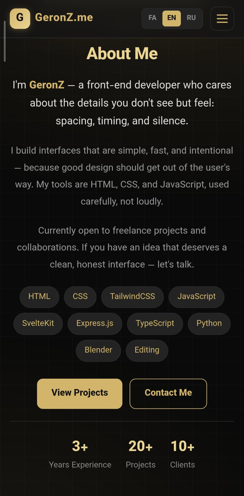

# GeronZ-Web
<div align="center">

# GeronZ.me

پورتفولیوی شخصی — توسعه‌دهنده فرانت‌اند، بازی و طراح دوبعدی/سه‌بعدی

[🌐 مشاهده سایت](https://geronz-86.github.io/GeronZ-Web/) · [🐛 گزارش مشکل](https://github.com/GeronZ-86/GeronZ-Web/issues) · [💬 تماس](https://t.me/GeronZ8)


</div>

---

## 📸 پیش‌نمایش



---

## ✨ ویژگی‌ها

- 🎨 **تم تاریک/طلایی** با طراحی مدرن و ظریف
- 🌐 **سه‌زبانه کامل** (فارسی، انگلیسی، روسی) با حفظ انتخاب کاربر
- 📱 **کاملاً واکنش‌گرا** — موبایل، تبلت، دسکتاپ
- ♿ **دسترس‌پذیر** — ARIA، `focus-visible`، `prefers-reduced-motion`
- ⚡ **بدون فریم‌ورک** — HTML/CSS/JS خالص، سریع و سبک
- 🔒 **امن** — مخفی‌سازی ایمیل، `noopener noreferrer`، referrer policy
- 🎭 **انیمیشن‌های ظریف** در هاور
- 🎯 **متغیرهای CSS** برای شخصی‌سازی آسان

---

## 🛠 تکنولوژی‌ها

| فناوری | کاربرد |
|---|---|
| **HTML5** | ساختار معنایی و دسترس‌پذیر |
| **CSS3** | Grid، Flexbox، متغیرها، Media Queries |
| **JavaScript (Vanilla)** | تعویض زبان، منوی موبایل، مخفی‌سازی ایمیل |
| **Vazirmatn** | فونت فارسی (Google Fonts) |
| **SVG** | آیکن‌های درون‌خطی برندها |

---

## 📁 ساختار پروژه

```
GeronZ-Web/
├── index.html              # کل سایت (HTML + CSS + JS)
├── img/
│   ├── G.jpg               # تصویر پروفایل
│   ├── favicon.svg         # آیکن تب مرورگر
│   ├── og-cover.jpg        # تصویر پیش‌نمایش شبکه‌های اجتماعی
│   ├── warborn.jpg
│   ├── joja.jpg
│   ├── shepherd.jpg
│   ├── bloodwar.jpg
│   └── islandmans.jpg
└── README.md
```

---

## 🚀 اجرای محلی

### روش ۱ — بدون سرور (ساده‌ترین)

```bash
git clone https://github.com/GeronZ-86/GeronZ-Web.git
cd GeronZ-Web
```

سپس فایل `index.html` را در مرورگر باز کن. تمام.

### روش ۲ — با سرور محلی (توصیه‌شده برای تست کامل)

```bash
# با Python
python -m http.server 8000

# یا با Node.js
npx serve .

# یا با PHP
php -S localhost:8000
```

سپس `http://localhost:8000` را باز کن.

> **چرا سرور محلی؟** چون بعضی رفتارها (مثل `localStorage` و مسیرهای نسبی) ممکن است در حالت `file://` متفاوت باشند.

---

## 🌐 تعویض زبان

سه زبان پشتیبانی می‌شود: **فارسی (`fa`)**، **انگلیسی (`en`)**، **روسی (`ru`)**

### نحوه‌ی کار

1. کاربر روی دکمه‌ی زبان در هدر کلیک می‌کند
2. تابع `applyLang()` تمام عناصر دارای `data-i18n` و `data-i18n-html` را جایگزین می‌کند
3. انتخاب در `localStorage` با کلید `geronz-lang` ذخیره می‌شود
4. جهت صفحه خودکار بین `rtl` و `ltr` تغییر می‌کند

### افزودن زبان جدید

در انتهای `index.html`، آبجکت `i18n` را گسترش بده:

```js
i18n.de = {
  'nav.home': 'Startseite',
  'nav.about': 'Über mich',
  'nav.projects': 'Projekte',
  // ... بقیه کلیدها
};
```

و یک دکمه به `.lang-switcher` اضافه کن:

```html
<button type="button" data-set-lang="de" aria-pressed="false">DE</button>
```

همین. سیستم خودکار بقیه را مدیریت می‌کند.

---

## 🚢 استقرار روی GitHub Pages

1. به **Settings → Pages** برو
2. **Source** را روی `Deploy from a branch` بگذار
3. **Branch** را `main` و پوشه را `/ (root)` انتخاب کن
4. **Save** کن
5. بعد از ۱–۲ دقیقه، سایت در `https://GeronZ-86.github.io/GeronZ-Web/` در دسترس است
6. 🔒 **حتماً گزینه‌ی `Enforce HTTPS` را فعال کن**

### دامنه‌ی اختصاصی (اختیاری)

اگر دامنه‌ای مثل `geronz.me` داری:

1. یک فایل `CNAME` در ریشه بساز و فقط دامنه را داخلش بنویس:
   ```
   geronz.me
   ```
2. در پنل DNS دامنه، رکوردهای `A` و `CNAME` را طبق [مستندات GitHub](https://docs.github.com/en/pages/configuring-a-custom-domain-for-your-github-pages-site) تنظیم کن

---

## 🔒 نکات امنیتی

| مورد | پیاده‌سازی |
|---|---|
| **مخفی‌سازی ایمیل** | ایمیل به Base64 تبدیل شده و فقط با JS دیکد می‌شود |
| **لینک‌های خارجی** | همه دارای `rel="noopener noreferrer"` |
| **Referrer** | `<meta name="referrer" content="strict-origin-when-cross-origin">` |
| **HTTPS** | فعال از GitHub Pages |
| **بدون ورودی کاربر** | هیچ فرمی پردازش نمی‌شود → XSS ممکن نیست |
| **بدون وابستگی خارجی حساس** | فقط Google Fonts (معتبر) |

### محدودیت شناخته‌شده

مخفی‌سازی ایمیل در برابر **ربات‌های ساده** (که فقط HTML می‌خوانند) کاملاً مؤثر است، اما ربات‌های پیشرفته‌ای که JavaScript اجرا می‌کنند (مثل Puppeteer) می‌توانند ایمیل را ببینند. برای راه‌حل قطعی، از **فرم تماس** (Formspree، Web3Forms) استفاده کن.

---

## 🎨 شخصی‌سازی

### تغییر رنگ‌ها

در `index.html`، ابتدای `<style>`، متغیرها را تغییر بده:

```css
:root {
  --gold: #D9B45F;        /* رنگ اصلی */
  --gold-light: #F0D48A;  /* رنگ روشن‌تر (تیترها) */
  --bg: #0a0a0a;          /* پس‌زمینه */
  --item-bg: #232323;     /* پس‌زمینه کارت‌ها */
  --border: #2a2a2a;      /* رنگ حاشیه */
  --header-h: 64px;       /* ارتفاع هدر */
}
```

### تغییر گرادیانت پس‌زمینه

بلوک `body` دوم در CSS را پیدا کن و `radial-gradient`ها را تنظیم کن.

### تغییر متون

دو جا را باید هم‌زمان به‌روزرسانی کنی:

1. **HTML** — متن پیش‌فرض (برای وقتی JS غیرفعال است)
2. **آبجکت `i18n`** — ترجمه‌های هر سه زبان

---

## 🧪 چک‌لیست قبل از انتشار

- [ ] همه‌ی تصاویر در `img/` موجودند و مسیرها درست‌اند
- [ ] `Enforce HTTPS` در تنظیمات Pages فعال است
- [ ] لینک‌های شبکه‌های اجتماعی به پروفایل‌های واقعی اشاره می‌کنند (Pinterest فعلاً placeholder است)
- [ ] متای `og:image` به یک فایل واقعی اشاره می‌کند
- [ ] سایت روی موبایل تست شده
- [ ] تعویض زبان در هر سه زبان کار می‌کند

---

## 📮 ارتباط

<div align="center">

| پلتفرم | لینک |
|---|---|
| 🌐 وب‌سایت | [geronz-86.github.io/GeronZ-Web](https://geronz-86.github.io/GeronZ-Web/) |
| 💬 تلگرام | [@GeronZ8](https://t.me/GeronZ8) |
| 🐙 گیت‌هاب | [@GeronZ-86](https://github.com/GeronZ-86) |
| 💼 لینکدین | [sobhan-hosseini](https://www.linkedin.com/in/sobhan-hosseini-a57991384) |
| 🐦 X | [@sobh_n86](https://x.com/sobh_n86) |
| 📷 اینستاگرام | [@sobha.n8668](https://instagram.com/sobha.n8668) |
| 📺 یوتیوب | [@GeronZ-86](https://youtube.com/@GeronZ-86) |

</div>

---

## 📄 مجوز

این پروژه تحت مجوز **MIT** منتشر شده است — استفاده، تغییر و توزیع آزاد است. لطفاً attribution را حفظ کن.

---

<div align="center">

**ساخته شده با ☕ و 🖤 توسط GeronZ**

اگر این پروژه برایت الهام‌بخش بود، یک ⭐ به ریپازیتوری بده

</div>
